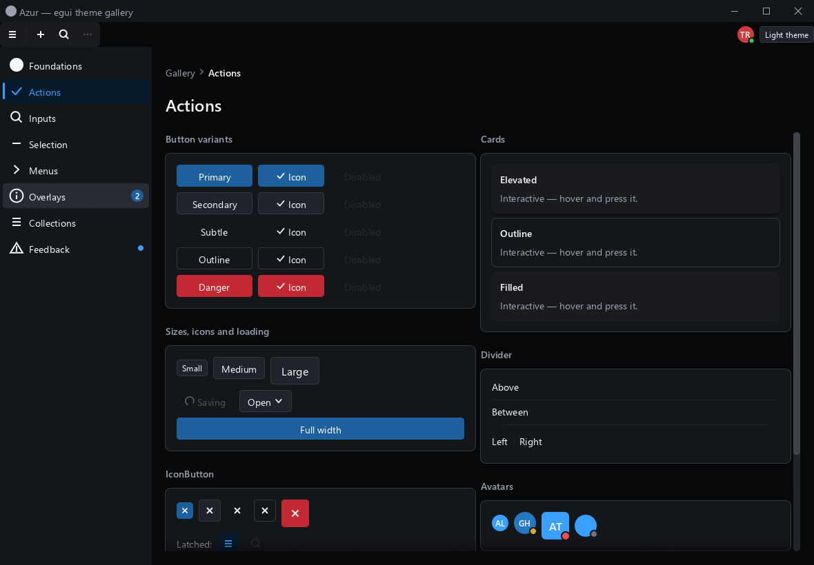
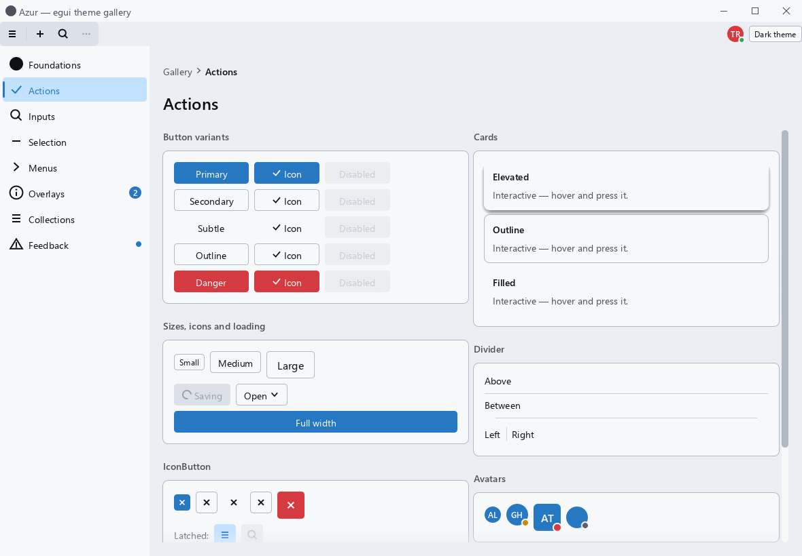

# azur-egui-theme

The [Azur design system](../azur-design-system) as an [egui](https://github.com/emilk/egui)
theme: the same tokens, the same semantic roles, and the components egui has no
equivalent for.

```
cargo run --example gallery
```

| Dark | Light |
| --- | --- |
|  |  |

## Four layers

| Layer | Module | What it holds |
| --- | --- | --- |
| Tokens | [`tokens`](src/tokens.rs) | The raw scales, transcribed whole from `tokens.css`: `GRAY_5`, `AZURE_ACCENT`, `radius::LARGE`, `shadow::S16`, `motion::FAST`. Values. |
| Roles | [`theme`](src/theme.rs) | What a color is *for*: `bg.card`, `stroke.subtle`, `text.secondary`, `accent.subtle_hover`. Decisions. |
| Style | [`style`](src/style.rs) | `egui::Visuals`, `Spacing` and the text styles, so egui's own widgets wear the token set. |
| Components | [`components`](src/components/) | Azur's components, for what egui lacks or draws differently. |

And four modules beside them, each answering a question the four layers cannot:

| Module | For |
| --- | --- |
| [`desktop`](src/desktop.rs) | The decisions a dense *application* window makes on top of the token set. Opt-in — see [below](#a-dense-application-window). |
| [`contrast`](src/contrast.rs) | Measuring a colour instead of counting the tokens between two of them. |
| [`render`](src/render.rs) | Which graphics backend the frame reaches the screen on, which is not the application's choice to make. |
| [`filter`](src/filter.rs) | What typing in a filter field *means*, which is as much a part of that component as its border — see [below](#a-filter-field-is-its-behaviour-too). |

Read and override the middle layer. A widget that reaches for `GRAY_5` directly
cannot be re-themed; one that asks for `bg.card` can. Nothing in `style` or
`components` picks a color of its own, so moving a role reaches egui's widgets,
Azur's components and your painted ones together.

Every field of `Theme` is one `--azur-color-*` custom property under the same
name — `--azur-color-background-card-hover` is `t.bg.card_hover` — which is what
makes `Theme::dark()` and `Theme::light()` checkable against `tokens.css` by
reading them side by side.

## Using it

```rust
// Fonts, dark palette, default density -- and the theme you paint with.
let theme = azur_egui_theme::install_dark(ctx);
```

Then use the components; they read the theme out of the `Context`, so a call site
does not have to carry it:

```rust
use azur_egui_theme::{components::*, icons};

Card::new().show(ui, |ui| {
    ui.add(Text::new("Registration").variant(TextVariant::Title));
    ui.add(TextField::new(&mut name).label("Project name").required(true));
    ui.add(Checkbox::new(&mut snap, "Snap to grid"));
    if ui.add(Button::new("Run").variant(Variant::Primary).icon(&icons::check)).clicked() {
        toaster.push(Toast::new("Started").intent(Intent::Success));
    }
});
```

Spelled out, which is what you want as soon as you have an opinion:

```rust
use azur_egui_theme::{fonts, install, tokens::control, tokens::palette, StyleOptions, Theme};

fonts::install(ctx);

let mut theme = Theme::dark();
// Azur's canvas is GRAY_0 -- very nearly black. Nothing else depends on it.
theme.bg.canvas = palette::GRAY_2;
theme.bg.layer = palette::GRAY_3;

install(ctx, &theme, &StyleOptions {
    control_height: control::SMALL, // dense, table-heavy window
    selectable_labels: false,       // rows are painted by hand
    ..Default::default()
});
```

Keep the `Theme` beside your app state for anything you paint yourself:

```rust
painter.rect_filled(rect, CornerRadius::same(radius::SMALL), theme.bg.card);
```

### Roles of your own

An app with domain colors (chart series, per-status hues) is best served by a
struct that holds a `Theme` and derefs to it, so both layers read the same at the
call site — `t.bg.card` and `t.cpu`, not `t.az.bg.card`:

```rust
pub struct Theme {
    az: azur_egui_theme::Theme,
    pub cpu: Color32,
}

impl std::ops::Deref for Theme {
    type Target = azur_egui_theme::Theme;
    fn deref(&self) -> &Self::Target { &self.az }
}
```

Deref coercion also means `&YourTheme` passes straight to `install`.

## A dense application window

Azur is specified for the browser, and this crate already leaves the CSS where a
desktop window is not a page — [square menus](#where-the-dark-theme-leaves-the-css-on-purpose),
controls a rung tighter, [no white surface](#where-the-light-theme-leaves-the-css-on-purpose),
filled accents two rungs down their ramps. Those are unconditional.

[`desktop`](src/desktop.rs) is the next layer of the same argument, and it is **opt-in**,
because it holds for one shape of window: dense, navigational, open all day. A file
manager, a process table, a launcher, a mixer. Panes divided by seams rather than
floating cards; hundreds of rows the pointer sweeps across. Nothing in it is a new
colour — it is Azur's own rungs, chosen for that window instead of for a page.

```rust
// Fonts, the dark palette adjusted for an application window, and the density.
let theme = azur_egui_theme::desktop::install(ctx, true);
```

```rust
// Or spelled out, for a window with roles of its own to move as well.
fonts::install(ctx);
let mut theme = Theme::dark();
desktop::apply(&mut theme);
install(ctx, &theme, &desktop::density());
```

**1. One hover, and it is a place rather than a control.** `apply` moves
`background-control-hover` *and* `background-card-hover` three rungs along the neutral
ramp; `desktop::hover_fill` reads the token back. Azur's hover ladder is written for a
control that wants to look liftable off `background-layer`, and most of what this shape
of window hovers is not a control — it is a row, a path segment, a folder in a tree, a
tab. A *place*, on a listing that is nearly black, where one rung is not enough to see:
ΔL\* 11.3 off the panel where the token asks for it, **28.5** where this puts it.

| | hover | press | primary text on the hover | secondary |
| --- | --- | --- | --- | --- |
| dark | `GRAY_8` `#4D525C` | `GRAY_9` | 7.5:1 | 2.9:1 |
| light | `GRAY_13` `#B3B9C4` | `GRAY_12` | 9.8:1 | 3.9:1 |

*Set the token, never the call sites.* That is not a preference, it is the bug this
module was extracted after: the window it came from moved its rows, its tree and its
path bar by hand, and Back, Forward, Up and Refresh went on wearing the old grey,
because they reach their fill through the token nobody had moved. Four buttons in the
middle of the window, a rung and a half off everything around them, and nothing in the
code looking wrong at either end.

The light rung is the dark one mirrored *by measurement*, not by eye — 2.5× the
distance the token asks for, on each side's own ramp. Taking the dark theme's hex value
across to the light theme, which is what the first attempt did, puts near-black body
text on a hovered row at **3.26:1**, under AA. A hover band is not an inverted row: the
ink does not change when the pointer arrives, so the fill has to stay on the ink's side
of the palette.

**2. A selected row is the accent as a surface — in the dark theme.**
`desktop::row_fill` takes `accent-active` at rest and `accent-default` under the
pointer, where Azur's list vocabulary says `accent-subtle`: on a near-black panel that
token is a navy barely off the surface. The light side keeps `accent-subtle`, and that
is not an omission — a row's ink does not change when it is selected, so on a light
window `accent-default` would carry near-black primary text at 4.3:1 and secondary at
**1.7:1**.

Every figure is sampled off the framebuffer, and the dark ramp was walked from the
wrong end: `AZURE_ACCENT` put a selected row's name at **2.5:1** and its metadata
columns at **1.06:1**; `accent-default` was halfway back at 6.05 and 2.51;
`accent-active` is **7.96 and 3.31**. Every step down bought legibility instead of
costing it, which is the tell that the bright first guess was three rungs past where it
should have stopped. The 2px bar down the row is `accent-mark` — the accent as ink,
which is that role's own job description, and the only rung that is not the colour of
the fill it sits on.

**A latched toggle wears the same surface.** `desktop::latched` returns that fill and the ink to
go on it, and the fill *is* `row_fill`'s selected one — one surface in this window means "on",
whatever is wearing it. A selected row and a latched button are the same statement, and a window
that says it two ways is one where you have to learn which is which. Azur latches an `IconButton`
in the `accent-subtle` ramp with `accent-mark` ink, which is right on a light page and is, in the
dark theme, the same navy `row_fill` declined: barely off the surface, so a toggle wearing it is
one you look at twice. The ink is `text-primary` at **7.96:1** where `accent-mark` on that fill is
3.13:1 — enough for a shape, and a toggle's whole job is to be read at a glance.

**3. Nothing structural is rounded.** `desktop::panel` is square, unringed and
marginless: `radius-medium` and `stroke-subtle` are right for a card floating on canvas
and wrong for a panel that *is* the window's structure. What divides two panels is
`desktop::seam` — one point of `stroke-subtle` — not a gap with a border on each side,
which is three lines wide and reads as a row of loose cards. `desktop::squared` is the
same rule for a field that has *replaced* something square and takes its shape while it
is up: a rename box over a row, a path field over a breadcrumb, a filter in a bar of
flush panels. `components::control_radius` is still right for a control you go *to*;
`desktop::structural_radius` is the other one, and there is no third.

**4. Rows are `row::DENSE` — 24 points — and they touch.** Azur's table row is 36,
sized for a form; a listing is read by scanning hundreds of lines, where every point of
row height is a line that did not fit. `row::TIGHT` is 22, for a sidebar entry or a
status line. And no `item_spacing` between them: the hover fill *is* the row, so 8
points between rows turns a sidebar into a column of buttons and costs a third of the
panel. `density()` cannot say that for you — it is a property of how a list is painted,
not a field of `Spacing` — so a hand-painted list computes `top + index * height` and
nothing else.

**5. Everything in a row is centred on its ink.** Its own section, [below](#everything-in-a-row).

One more thing the module carries, because every window with a menu in it needs it and
egui does not do it: `desktop::close_popups_on_blur(ctx)` puts every popup away when the
window loses focus, and returns whether it fired so the caller's own latched state goes
with it. A menu belongs to a moment. Click into another window with one open and it is
still there when you come back — pinned over content it no longer describes, and in the
case of a context menu, over a selection the click may have changed.

## Everything in a row

The rule that has to be said the most often, so it is code rather than prose:

- **A glyph is centred by its ink, not by its box.** The box is what a caller centres,
  so art that sits low in its own box sits low in every row it ever appears in — see
  [`icons.md`](docs/icons.md), which is the glyph's half of this.
- **Text sits on a baseline, and a row has *one*.** Not one per column, not one per
  font. `components::row_baseline` for a row of text alone,
  `components::ink_baseline` for a row that also holds a glyph, and
  `components::galley_on_baseline` to put each galley on the answer.

The second of those is the one that surprises people. A line box reserves room under
the baseline for descenders and above the capitals for accents; a file name uses
neither, so text centred by its *box* hangs below a glyph centred on its *ink*.
Measured on Segoe UI at `pixels_per_point` 1:

| | 12px | 14px | 16px |
| --- | --- | --- | --- |
| line box | 16.00 | 19.00 | 21.00 |
| ascent | 13.00 | 16.00 | 17.00 |
| ink above the baseline | 9.00 | 10.00 | 11.00 |
| **the ink sits this far low** | **0.50** | **1.50** | **1.00** |

`ink_baseline` centres the band from the top of the ascenders down to the baseline and
lets the descenders hang out of it, which is what a typographer means by the middle of
a line and what the eye reads as level. `ink_lift` is the same figure on its own, for a
caller that would rather shift a rect it already centres than switch to baselines.

The application this came out of found the number three times by eye — a listing's
cells, a path segment, a tab's label — and wrote `2.0` in three different files, having
noticed nothing until a guide drawn through an icon's centre came out above the x-height
of every name in the window. 1.5 is the measured figure at body size, and after the
pixel snap both land on the same row.

## The edge of a scrolling list

A list, table or log cut off mid-row looks like one that *ends* there. The scrollbar says
otherwise, and it is a thin thing down the far side of a panel nobody is looking at the far
side of — so the surface comes back over the content at whichever edge there is more past:

- **A fade, not a rule and not a shadow.** The content stays legible through the shallow
  end of it, which is what reads as *continues* rather than as *ends*. A rule reads as the
  bottom of the list.
- **At most 16 points**, and only as deep as there is to scroll — so it grows in as the
  first row goes under rather than snapping on at full depth.
- **The surface's own colour**, not a new one and not black: this is the fill the rows sit
  on, returning over them. It survives a theme switch and a moved role.
- **Scrollbars excluded.** A fade drawn over a scrollbar makes the bar look like it is
  dissolving.

`ListView`, `TreeView` and `Table` do it themselves. `components::scroll_fades` is the rule
for a collection an application paints by hand — a file listing, a document, a console log —
and `components::scroll_fades_of` measures the two numbers off a finished `ScrollArea` for
the common case where the content is all there is.

One thing the derived version cannot know: a region that reserves trailing slack past its
last row has to pass its own figures, or the bottom fade says there is more to read where
nobody put anything.

## Measuring, not counting

Every claim on this page about a colour being legible, too loud or too close to its
neighbour is a measurement, and [`contrast`](src/contrast.rs) is the ruler: `ratio` for
ink on a fill, `apart` for two surfaces, `over` first for anything translucent. It is
public because the claims do not stop at the crate boundary — an application that adds
a role of its own has made the same kind of claim.

**Counting tokens is not measuring contrast.** "Four steps up the ramp" is not a
quantity of anything: the dark neutral ramp is perceptually finer than the light one, so
the same number of named steps is a different amount of contrast on each side. This
system's panel seam used to be `background-control-active`, which is **four** names above
`background-layer` in the dark theme and **two** in the light one — a glaring asymmetry
in the names, and ΔL\* **15.4** against **13.9** in CIELAB. Nothing was wrong with it; it
was simply more contrast than wanted, which is a different sentence and leads to a
different fix.

`TEXT` (4.5:1) and `SHAPE` (3:1) are WCAG's, and they are about ink. `SAME` — 3 ΔL\* —
is not a standard: it is the point below which two neutral surfaces stop reading as two
surfaces, and it exists because a multi-pane window is mostly that problem. A seam
against the panel it divides, a header against the bar above it, a hover against the row
beside it: WCAG has nothing to say about any of them, because none of them is ink.

And for anything whose real colour is decided by the renderer rather than by a token —
antialiased text, a fill under a wash under a selection — **measure it off the
framebuffer**. This module measures the palette; a screen capture measures the window,
and only the second one catches a colour that two correct decisions produced together.
Note what [`render`](src/render.rs) says about screen captures before trusting one for
anything sharper than a colour.

## Components

Everything in Azur's component list, as `egui::Widget`s or `show()` containers.
Each one's fills, lines, radii, heights and fonts are the tokens the matching
`*.module.css` names; where one deviates, the comment says from which line and
why.

| Group | Components |
| --- | --- |
| Actions & layout | `Button`, `IconButton`, `Card`, `Divider` |
| Text inputs | `TextField`, `TextArea`, `NumberField`, `SearchBox` |
| Selection | `Checkbox`, `Radio`/`RadioGroup`, `Switch`, `Slider` |
| Menus & choice | `Popover`, `Menu`/`MenuItem`, `ContextMenu`, `Select`, `ComboBox` |
| Overlays | `tooltip`, `Dialog`, `Drawer` |
| Collections | `ListView`, `TreeView`, `Table`, `Tabs` |
| Feedback | `ProgressBar`, `Spinner`, `Badge`, `MessageBar`, `Toast`/`Toaster` |
| Navigation & chrome | `Text`, `Avatar`, `Breadcrumb`, `CommandBar`, `NavigationRail`, `TitleBar` |

### A composite field is the application's, its border is not

The set has `TextField`, `SearchBox`, `NumberField` — whole controls, each a label, a wrapper, an input
and a message. What it has no component for is a field with **several controls inside it**: an editor's
find bar, with match-case, whole-word and regex toggles sitting in the right-hand end of the field, or
a path field with a button on the end. Those are compositions, and laying one out is the
application's job.

What must not be re-derived is the part that makes it look like a field at all, so
[`field_frame`](src/components/inputs.rs) is public: one fill, one radius, and the **four-state
border** — subtle when disabled, `danger` on error, `focus` when focused, `strong` when hovered,
`control` otherwise. Reserve a slot with `ui.painter().add(Shape::Noop)` before the input and call it
after, with the input's own `has_focus()`; the border depends on focus, and focus is only known once
the input has run. `field_hovered` goes with it, because "is the pointer over this field" is not the
wrapper response's `hovered()` — the input inside is the topmost widget over the text area and takes
the hover from it, which leaves a border that lights up only where you are *not* typing.

`tooltip_at_pointer_ui` is the same idea for the one tooltip that is not a sentence. A tooltip's measure
here is a paragraph's — `spacing.tooltip_width`, 280 — because a tooltip is read in one glance and a long
line is not; a row of a file listing, which has a name, a type, a size, a date and a state to say about
the same thing, reads as a small table instead, and laid out in that measure every value long enough to
matter wraps under its own key. So this one takes a body the caller draws and has **no measure of its
own**: the window is the only bound and the frame hugs the table. The frame, the anchor and the delay are
still the component's — a hand-rolled popup beside it would be a second tooltip that nearly matches.

`TextField::text_lift` is the other thing a caller cannot do from outside, and it is the line-box
correction: text centred in a box is centred on its *line box*, which reserves room under the baseline
for descenders, so a field of mostly-x-height text reads a point or two low **beside glyphs centred on
their own ink**. Zero by default, and it stays zero in a form — there the box is what the field is
aligned to, and the platform's own fields centre the same way. It is worth setting when the field is one
item in a toolbar of icons, which is where the icons are what the text has to come level with. Only the
text and the placeholder move; the frame, the affixes and the ✕ are already right. It is the same
correction [`ink_baseline`](src/components/mod.rs) makes for text a caller paints itself.

### A filter field is its behaviour too

A `SearchBox`, a `TextField` with a funnel in front of it, the needle in a `ComboBox`: the
look of that field is specified here, so **what typing in it does is specified here as
well**. [`filter`](src/filter.rs) is that half. A filter that means one thing in one window
and something else in the next is the same kind of inconsistency as two greys, and it is
the worse of the two, because you cannot see it — a field that takes four terms looks
exactly like a field that takes one substring.

```rust
let q = azur_egui_theme::filter::Query::parse("wor he");
q.matches("hello world");  // true
q.matches("world hello");  // true  — any order
q.matches("hello to you"); // false — every word must be there
```

| typed | keeps |
| --- | --- |
| `report` | anything containing `report`, in any case |
| `wor he` | anything containing **both**, in **either order** |
| `!tmp` | anything *not* containing `tmp` |
| `^src` | anything **beginning** with `src` |
| `.rs$` | anything **ending** with `.rs` |
| `^a$` | exactly `a` |
| `!^~` | anything not beginning with `~` |

**Words in any order is the whole point.** One substring is a poor way to find something
you half remember: you know two things about it and not which comes first — a project and
an extension, a machine and a date, a surname and a street. Two half-memories becoming one
query is what makes this worth a syntax rather than a `contains`.

**There is no regex engine, and the reason is not the dependency.** "Every word, any order"
is `(?=.*a)(?=.*b).*`, and that shape is the argument against: [`regex`](https://docs.rs/regex)
**cannot express it** — no lookahead, by design, because lookahead is what costs it the
linear-time guarantee. Expressing it needs a backtracking engine, which is the one thing a
filter field must not have: the pattern comes from someone typing, and it is asked of one
candidate at a time over a list that can be hundreds of thousands long. And there is
nothing left for an engine to do. A chain of lookaheads over literals says "each of these
appears somewhere", which is a loop and a substring test; the anchors and the negation are
that same test twice more.

Which is also why **the words are literals**. `a.c` finds `a.c` and not `abc` — a filter
field is where you type a fragment of a name, and a name is full of `.`, `(`, `+` and `-`.

Two smaller decisions worth knowing:

- **Every prefix of a query has to mean something**, because every prefix gets typed on the
  way to it. A term that is nothing but markers — `^`, `!`, `^$` — is dropped rather than
  matching nothing, so `^`, then `^s`, then `^sr` narrows the whole way down instead of
  emptying the list on the first keystroke and filling it again on the second.
- **A doubled marker is the marker itself.** `!!` finds a literal `!`, which is the only
  way to filter for a name that begins with one; `$$` a literal `$` at the end.

`SYNTAX` is the two-line description of all of it, so the tooltip beside the field says the
same thing in every window that has one.

### A shortcut in a tooltip is set in `text-secondary`

`Refresh (F5)` is two things, and they are not the same kind of thing: a sentence saying what
the button does, and an aside saying how to do it from the keyboard. So [`tooltip`](src/components/overlays.rs)
sets the aside in `text-secondary` — one galley with two sections, because the two have to sit
on one baseline and break as one paragraph, where two labels in a row would let `(F5)` be
orphaned onto a line of its own. The brackets go with the aside: once the colour says it is one,
they are furniture.

**It is recognised rather than passed in**, and that is the decision worth defending. A tooltip is
one string at every call site in every application built on this — it is what `tooltip("Up (Alt+Up)")`
takes, it is often what the widget's `Id` is keyed on, and `Label (Keys)` is already the
convention Windows itself writes them in. An extra parameter would have to be threaded through
every wrapper on the way down and forgotten by the first caller who did not know the rule
existed; recognising the shape means the rule reaches tooltips written before it did.

Which puts all the weight on the guard, because the failure to avoid is a *prose* parenthetical
going grey — `Show hidden files (including dotfiles)` must not lose its ending. So
[`shortcut_in`](src/components/overlays.rs) asks for all of: a `)` at the very end with a
matching `(` that has a space and a sentence before it; **no whitespace between the brackets**,
which is what a real aside fails and no chord ever does; every `+`-separated part starting with
an uppercase letter or a digit, which is how key names are written and how `(optional)` is
caught; and at least one uppercase letter, so `(2)` is a count rather than a key. What it will
still take is a one-word capitalised aside — `(Beta)` — and dimming that is a small wrong: it
reads as an aside either way.

The menu's own shortcut slot is `text-tertiary` rather than this, and stays there. A `MenuItem`'s
shortcut sits in a column of its own with a whole menu of labels beside it; a tooltip's is inline
in a sentence on a popover, where one rung further down starts to disappear.

## Icons

Painted, not a font: Azur ships its own as inline SVG, so [`icons`](src/icons.rs)
has the chrome glyphs the components need — chevrons, checks, window buttons,
status marks — as painters. Anything with the same shape works, so an application
passes its own the same way:

```rust
fn my_glyph(p: &egui::Painter, r: egui::Rect, c: egui::Color32) { /* ... */ }
ui.add(Button::new("Mine").icon(&my_glyph));
```

Only the *system's* glyphs live here. An application's own — Print, Export,
Measure — belong to the application, and they end up in the same rows as these,
so they have to be built the same way.

**[docs/icons.md](docs/icons.md) is the brief for that**, in two parts:

- **Glyphs inside the window** — the contract an `Icon` has to keep, the 16-unit
  grid, one weight from `icons::stroke_width`, why the color always comes from the
  caller, the box each component hands out, how to transcribe an SVG.
- **The icon on the executable** — the raster mark Explorer and the taskbar show,
  which follows none of those rules: the sizes to ship, why 16 and 32 are redrawn
  rather than downscaled, the plate and its 25% corner, which palette colors
  survive a light *and* a dark taskbar, and the `build.rs` that gets it into the
  `.exe`.

`icons::Pen` is the first part as code — coordinates go in as the numbers written
in the `viewBox`:

```rust
/// <svg viewBox="0 0 20 20"><rect x="3" y="5" width="14" height="10" rx="1.5"/>
///   <path d="M4 6l6 5 6-5"/></svg>
pub fn mail(painter: &egui::Painter, rect: egui::Rect, color: egui::Color32) {
    let pen = icons::Pen::new(painter, rect, color).units(20.0);
    pen.rect(3.0, 5.0, 14.0, 10.0, 1.5);
    pen.path(&[(4.0, 6.0), (10.0, 11.0), (16.0, 6.0)]);
}
```

That file is included into the crate docs, so every example in it is compiled by
`cargo test`.

## What does not survive the port

Transcribed for reference, not applied:

- **Line heights.** An `egui::FontId` carries a size and a family, not a leading.
  The components use `tokens::typography::LINE_*` for the rows they lay out.
- **Two of the four font weights.** egui picks a weight by picking a family, and a
  platform UI family has two faces worth loading: Segoe UI is 400 then 600, with no
  500. So `font-weight-medium` — a button label, a tab, a field label, a badge —
  rounds *down* to regular, and only the 14 genuinely semibold roles get the heavier
  face. Rounding medium up made every button label heavier than the body text
  beside it.
- **Easing curves.** egui animates on one fixed curve. `tokens::motion` keeps the
  CSS control points and a `cubic_bezier` evaluator for anything you animate.
- **Z-index.** egui orders by `egui::Order`, not by number. `tokens::layer` maps
  each `--azur-z-*` stop onto the order that holds the same rank.
- **The focus ring.** CSS gets it from `outline`, which paints outside the border
  box without taking part in layout; egui has nothing equivalent, so
  `icons::focus_ring` strokes a grown rect and can spill into a tight neighbour.
  Where Azur itself is tight it uses a negative offset, which is
  `focus_ring_inset`.
- **CSS transitions**, per property. egui cross-fades widget state on
  `Style::animation_time`, which `install` sets to `motion::FAST`; the components
  that genuinely animate — `Spinner`, an indeterminate `ProgressBar`, `Switch`,
  `Toast` — drive themselves off the frame clock.

## Where the dark theme leaves the CSS on purpose

Two, both about filled accent surfaces, both because a desktop window is a dark
canvas where a web page is a light one.

**Filled accent and danger are two rungs darker.** The CSS fills a primary button
with `azure-accent` (`#3AA0FF`) and a destructive one with `red-70` (`#EA4D54`),
white text on both. On a near-black canvas those read as light sources rather than
controls — and the white on them measures 2.7:1 and 3.7:1, under the 4.5:1 a label
needs. So the *fills* move down their ramps:

| | primary | danger | white on them |
| --- | --- | --- | --- |
| CSS | `#3AA0FF` | `#EA4D54` | 2.7:1 / 3.7:1 |
| here, at rest | `#1D609D` | `#C22932` | 6.5:1 / 5.7:1 |
| hovered | `#2678C2` | `#D63A41` | 4.6:1 / 4.6:1 |
| pressed | `#184E80` | `#B2252E` | 8.6:1 / 6.6:1 |

Every state clears AA for its label, where the CSS cleared none. The cost is at the
button's edge: 3.1:1 against the canvas, 2.6:1 against a card, below the 3:1 WCAG
asks of a boundary — a figure meant for controls identified *by* their boundary
rather than by a label at 6.5:1.

The same hues stay bright where they are **ink** rather than a surface — a pressed
button's label, a selected rail entry, a `Select` tick, a 2px selection bar, an
error message, a spinner, the focus ring. That is what `accent.mark` and
`status.danger` are, split from `accent.default` and `status.danger_solid`, which
the CSS spells with one value each because on a light page one value works.
`theme.rs`'s tests measure every pairing; `Theme::dark`'s docs show how to put the
CSS values back, or how to stop one rung short.

**Controls are `radius-small`, not `radius-medium`.** 4px rather than 6px on a
button, an icon button, a text field and a `Select` or `ComboBox` trigger — one step
down the same scale, because 6px on a 24px-tall control reads as a pill.
`components::control_radius()` is the single place it is decided, and
`CornerRadius::ZERO` there is the literal pre-11 Windows control if you want it.

The rows follow: a `NavigationRail` entry's hover and selected fills are
`radius-small` too, where the CSS says `radius-medium` — 6px on a 36px row that runs
the width of the rail reads as a floating pill rather than a band of the panel, and a
tighter corner keeps clear of the 3px selection indicator down its left edge. That
matches `ListRow` and `TreeView`, which were already there.

Surfaces are not rows: a card and a dialog stay `radius-large`, a message bar stays
`radius-medium`, and a switch, a badge and an avatar are round by definition.

**Menus are shaped like a desktop menu, not a web one.** Azur's menu is a
`radius-large` card with `space-2` of padding and `space-1` between rows — the
Windows 11 look. `menu_frame` is the pre-11 one instead, and the parts are all in
`components::menus`:

- square corners, and no horizontal padding, so rows run border to border
- a highlight that is a full-width band rather than a pill floating inside the popup
- separators that cut the full width
- an icon gutter that is fixed **within a menu that has one** — see below
- a filled caret for a submenu (`icons::caret_right`) where Azur uses a chevron
- 28px rows: `space-2` either side of a body line rather than `space-3`, which is
  [`row::COMPACT`](src/tokens.rs), the height Azur's own `ListView` uses at
  `density="compact"`

The paint is untouched — `background-layer-alt`, `stroke-subtle`, `shadow-16`, and
every color from the theme. `popover_frame` keeps Azur's rounded, padded surface for
`Popover`, which holds arbitrary content rather than rows;
`menu_item_height_comfortable()` and `MenuItem::height` put the web density back.

### The icon column belongs to the menu, not to the entry

**A menu reserves the leading icon-or-tick column only if it may show one.** Within a
menu that does, every entry reserves it whether or not that entry fills it — that is
what lets the eye run down the labels instead of following a ragged left edge as icons
come and go, and it is what a classic Windows menu does. Within a menu that cannot,
there is nothing to line up with, and 24 points down the left-hand side is an indent
with no cause.

Which it is, is one decision per menu and not one per row:

| container | how |
| --- | --- |
| `Menu`, `ContextMenu` | `.icons(bool)` — applies to whatever the content closure adds |
| `Select`, `ComboBox` | `.icons(bool)` — drops the tick on the current option with it |
| a hand-built popup | `MenuItem::gutter(bool)` on each entry |

Default on, because most menus in an application do show something: a tick beside the
setting that is in force, a glyph beside a file command. Off is for a menu of **plain
values** — a zoom, a font size, a line height, a list of encodings — where nothing can
appear there.

Two consequences worth stating, because both are the kind of thing that gets "fixed"
back:

- **Turning it off on a `Select` or a `ComboBox` also drops the tick.** The two cannot
  be separated: a tick with no column would be drawn over a label. That is the right
  trade for a list of values, where the trigger already shows which one is current — in
  a field you can read without opening anything. A tick in a list you have to open is
  the weaker of the two places to say the same thing.
- **An entry that really has an icon or a tick keeps the column regardless.** A caller
  who has said "no icons" and then passed one is better served by a ragged menu they can
  see than by a glyph that silently vanished.

`MenuItemMetrics` has both sums — `width` and `width_without_icons` — because a caller
that places its own popup has to know which menu it is sizing. Getting that wrong fails
in the direction that truncates: 24 points too narrow does not look misplaced, it looks
like somebody shipped `Copy pa…`.

## Where the light theme leaves the CSS on purpose

One, and it is the mirror image of the dark one: **no surface is white.** The CSS
ladder is `WHITE` → `GRAY_16` → `GRAY_15`, which is a *document's* — a browser
window is one page, mostly text, looked at for as long as it takes to read. An
application window is a screen of chrome that stays open all day, and pure white
across that much area is what people mean when they call a light theme aggressive.

| | sheet — panels, cards, controls | canvas — the window | shade — menus, hovers, stripes |
| --- | --- | --- | --- |
| CSS | `WHITE` | `GRAY_16` `#F5F6F8` | `GRAY_15` `#E4E7EC` |
| here | `#F7F8FA` | `#EBEEF3` | `#DCE0E8` |

The ladder moves *as* a ladder: what makes a card read as raised and a menu as set
into its panel is the distance between the rungs, not where the top one is, and
those distances are the CSS's within a hundredth — 1.09:1 sheet to canvas against
1.08:1, 1.25:1 sheet to shade against 1.24:1. The three values are
[`tokens::paper`](src/tokens.rs), interpolated on the gray ramp because it has no
steps this fine at the top; nothing else moves, and `Theme::light`'s docs put the
white back in nine lines.

The cost is at the same place dark pays it, and smaller: a primary button's edge is
3.97:1 against the canvas where white gave 4.27:1, still over the 3:1 WCAG asks of a
boundary. Secondary text is 5.9:1 at worst, body text 14.5:1, and `theme.rs`'s tests
measure both on every surface.

## Where egui's vocabulary is smaller than Azur's

`egui::Visuals` has one field where Azur has two or three. Each collision goes to
whichever consumer is most common, and the components paint the exact spec for the
rest. The three worth knowing:

- **`widgets.*.bg_fill`** is a slider rail (`stroke-subtle`), a checkbox box
  (`background-control`) *and* a scrollbar handle (`scrollbar-thumb`). It goes to
  the scrollbar, because that is the only one of the three `components` cannot
  replace.
- **`selection.bg_fill`** is a text-selection highlight, a slider's trailing fill,
  a progress bar *and* a selected `SelectableLabel`. It takes `accent-default`,
  right for the first three; [`list_items`](src/widgets.rs) puts `accent-subtle`
  back for popups of selectable rows, which is what Azur's lists use.
- **`window_fill`** is both a popover and a dialog panel. It takes
  `background-layer-alt` (the popover), and `Dialog` / `Drawer` set
  `background-layer` themselves.

Two more egui behaviours the theme handles, documented because they look like
theme bugs when you meet them in your own code:

- **The scrollbar handle** is painted with `fg_stroke.color` when
  `ScrollStyle::foreground_color` is on (egui's default), which in any theme with
  light body text is a near-white bar down the side of every scroll area. The
  theme turns that off so the handle takes `bg_fill`.
- **`Button::selectable`** draws no frame until hovered, and `Frame::total_margin`
  counts the stroke — so a hovered entry is 2px wider, which widens the popup,
  which widens the entry. In a combo box that oscillates under the cursor.
  `list_items` clears the stroke in every state.

## Checking compliance

`tokens.rs` is the diff surface: every `--azur-*` property in `tokens.css` appears
there, under the same name, in the same order — including steps no role uses, so a
missing one is visible by reading. `theme.rs` then maps them to roles in the same
order as the `[data-theme]` blocks.

When `tokens.css` changes, the order to work in is: `tokens.rs`, then the two
`Theme` constructors, then `style.rs` if a role that egui reads has moved, then
the affected component. The gallery is the visual test — every component, every
state, both palettes:

```
cargo run --example gallery                 # dark, Foundations
cargo run --example gallery -- light         # light
cargo run --example gallery -- --section=6   # straight to Collections
```

The two images at the top of this file are made by the gallery itself, not
captured by hand — so they can be regenerated after any change to the roles:

```
cargo run --example gallery -- --section=1 --screenshot=docs/gallery-dark.png
cargo run --example gallery -- light --section=1 --screenshot=docs/gallery-light.png
```

## Version compatibility

A theme is only meaningful for the exact egui it styles. This crate tracks **egui
0.35**, and your app must resolve to that same version: two egui versions in one
dependency graph are two different `Context` types, and the theme would silently
style neither. `cargo tree -d -p egui` will tell you if that happened.

## Consuming it

Path dependency, as a sibling checkout:

```toml
[dependencies]
azur-egui-theme = { path = "../azur-egui-theme" }
egui = { version = "0.35", default-features = false }
```

Or over git, once this is pushed somewhere:

```toml
azur-egui-theme = { git = "…/azur-egui-theme", tag = "v0.1.0" }
```

## Shipping the binary

[`deploy`](src/deploy.rs) is `cargo deploy`: build the release binary and copy it to where
it is actually run from.

```
cargo deploy                     release build -> D:\Programs (or $AZUR_DEPLOY_DIR)
cargo deploy E:\Tools            somewhere else
cargo deploy --debug             the debug build, for once
cargo deploy --profile fast      a profile of the package's own
```

It is here for the same reason [`render`](src/render.rs) is: it is a decision about how an
Azur application is *built* rather than about how it looks, every application that consumes
this crate needs it, and none of them is the right place for it: it was two hundred lines in
the file explorer and nothing at all in the other two, and the alternative to moving it was
copying it twice into files that would then differ only in the name of an executable. Nothing
in it draws anything or touches an `egui::Context`, and nothing in a window can reach it.

An application opts in with two files, neither of which holds any of the work.
`.cargo/config.toml`:

```toml
[alias]
deploy = "run --quiet --release --example deploy --"
```

and `examples/deploy.rs`:

```rust
fn main() -> std::process::ExitCode {
    azur_egui_theme::deploy::main(azur_egui_theme::deploy::Program {
        bin: env!("CARGO_PKG_NAME"),
        manifest: env!("CARGO_MANIFEST_DIR"),
    })
}
```

Those two `env!`s are the reason there is a file at all. `env!` can only answer where it is
written — asked inside this crate it would name this crate, and deploy the theme.

**Why an example target.** `cargo` has no post-build hook: `build.rs` runs *before* the
build and never sees its own output, and an `[alias]` can only stand for a cargo subcommand,
so it can build or it can run but not build and then copy. What it can do is *run* something
that does both. An example rather than a second `[[bin]]`, which would force `default-run` on
the package before `cargo run` meant anything again, and rather than an `xtask` crate, which
would mean a workspace per application to hold one file. The alias asks for `--release` so
the helper costs nothing extra: the dependencies it needs are the ones the release build is
about to want anyway.

**It replaces a copy that is running,** which is the state the destination is in whenever you
have the thing open to look at what you just changed. Windows will not let you overwrite the
image of a running process, but it will let you *rename* it — the image stays mapped from
wherever the file went. So a copy that fails for sharing moves the old binary to
`<name>.exe.old` and copies again, and the next deploy sweeps that away. The open window
keeps working; it is simply still the old build, which it was anyway. The sweep takes back
exactly the names it hands out and no others: `<name>.exe.old-keep-this` is somebody's file.

And it copies **nothing** if the build failed, which is the whole point — a deploy that
quietly leaves yesterday's binary in place is worse than one that stops.
