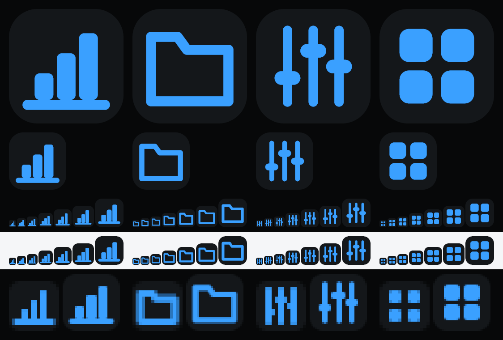

# Application icons

Four applications, two media each, one definition per mark.

| | task manager | file explorer | audio mixer | program launcher |
| --- | --- | --- | --- | --- |
| mark | three columns on a rule | a folder with a tab | three faders, knobs staggered | a 2×2 tile grid |
| folder | `task-manager/` | `file-explorer/` | `audio-mixer/` | `program-launcher/` |



The sheet above is generated with the icons, so it cannot go stale. Columns are in
the order of the table; rows are 256, 128, the small sizes on dark, the same on
light, then 16px at 7× and 32px at 4× so the pixels can be counted.

## Colors

| | value | what it is in the theme |
| --- | --- | --- |
| plate | `#14171A` | `GRAY_2` — the dark theme's `bg.layer` |
| mark | `#3AA0FF` | `AZURE_70` — the dark theme's `accent.mark` |

Both are Azur palette values, so the desktop icon is in the same paint as the
window it opens. The mark measures **6.6:1** against the plate.

This is the "dark chrome" row of [`docs/icons.md`](../docs/icons.md) §15. One thing
that section tells you to check, and which is worth knowing here: the plate is
**1.1:1 against a dark taskbar** (`#14171A` on Windows 11's `#1C1C1C`). On a light
taskbar it is a deliberate dark tile at 16.6:1; on a dark one it disappears and the
icon reads as a blue mark floating on the taskbar — which is how a good many
Windows 11 icons look, but it is a choice rather than an accident. If you want the
tile to read on both, lift the plate to `GRAY_4` (`#202329`, 1.9:1) or give it a
one-pixel rim; `PLATE` in `examples/app_icons.rs` is the only place to change.

## What is in each folder

- `app-16.png` … `app-256.png` — 16, 20, 24, 32, 40, 48, 64, 128, 256. The sizes
  Windows asks for, plus the display-scaling steps between them.
- `app.ico` — all nine, PNG-compressed, for the executable's resources.

## Using them

**The executable icon.** Windows reads it from the PE resource, so it is a build
step:

```toml
# Cargo.toml
[build-dependencies]
winresource = "0.1"
```

```rust
// build.rs
fn main() {
    if std::env::var_os("CARGO_CFG_WINDOWS").is_some() {
        winresource::WindowsResource::new()
            .set_icon("app-icons/task-manager/app.ico")
            .compile()
            .unwrap();
    }
}
```

**The window icon.** Set it too, or the taskbar button switches to egui's default
white `e` the moment the window opens:

```rust
let options = eframe::NativeOptions {
    viewport: egui::ViewportBuilder::default()
        .with_icon(
            eframe::icon_data::from_png_bytes(include_bytes!(
                "../app-icons/task-manager/app-256.png"
            ))
            .unwrap(),
        )
        .with_decorations(false), // drawing Azur's own `TitleBar`
    ..Default::default()
};
```

**The title bar.** Copy [`marks.rs`](marks.rs) into the application — it is
self-contained apart from `azur_egui_theme::icons::Pen` — and hand the function to
`TitleBar`:

```rust
mod marks;

TitleBar::new("Sessions").icon(&marks::task_manager).maximized(max).show(ui);
```

The same functions are ordinary `Icon`s, so they work anywhere one is taken —
`Button::icon`, `CommandItem::button`, `MenuItem::icon`, `NavItem::icon`. There
they take their weight and color from the component, which is what keeps them
level with the built-in chevrons and ticks beside them.

## Regenerating, and adding a fifth

```sh
cargo run --example app_icons
```

Everything here except this file is written by that example. To add an
application: add a `Mark` to `marks.rs`, list it in `ALL`, and run the command —
the folder, the nine PNGs, the `.ico` and the preview column all follow.

The marks are geometry (`Prim`: stroked polyline, closed polyline, line, rounded
rect) on the same 16-unit grid an Azur SVG uses. The generator rasterises those
primitives directly — no egui, no GPU, no window — and `marks::paint` draws the
same primitives with `Pen`. That is why the title-bar icon and the `.ico` cannot
drift apart: there is one set of coordinates.

## Choices worth knowing

- **The small sizes are not downscales.** Below 48px the generator snaps every
  axis-aligned edge to whole pixels and rounds the stroke to a whole number, and
  below 32px it floors the stroke at 2px. A 1.4-unit stroke would otherwise be
  1.4px at 16px and read as gray.
- **A gap has to survive being one pixel.** The launcher's tiles were first drawn
  0.8 units apart, which is 0.8px at 16px: snapping rounded it away and all four
  tiles fused into a single rounded square. They are 1.2 units apart now. Anything
  that separates two shapes needs a whole pixel at the smallest size.
- **Solid where an outline would be a seam.** `docs/icons.md` §4 is outline-first,
  and the bars, knobs and tiles are filled — a 2.6-unit bar stroked at 1.4 units is
  a solid bar with a line down the middle. The folder, which is wide enough to hold
  an outline, has one.
- **The raster mark has round caps; the painted one does not.** The rasteriser
  measures distance to a segment, which rounds the ends the way Azur's
  `stroke-linecap="round"` does. `egui::Stroke` has no cap setting, so the title-bar
  version has butt ends. At 16px it is sub-pixel; it is the same gap §10 of the
  guidelines records.
- **`.ico` entries are PNG, including the 256.** `System.Drawing.Icon` parses the
  file and picks every entry up to 128 — it does not select the 256, which is a GDI+
  limitation rather than a defect in the file: the entry is present, 32-bit, and
  byte-identical to `app-256.png`, and the Explorer shell is what reads it.
